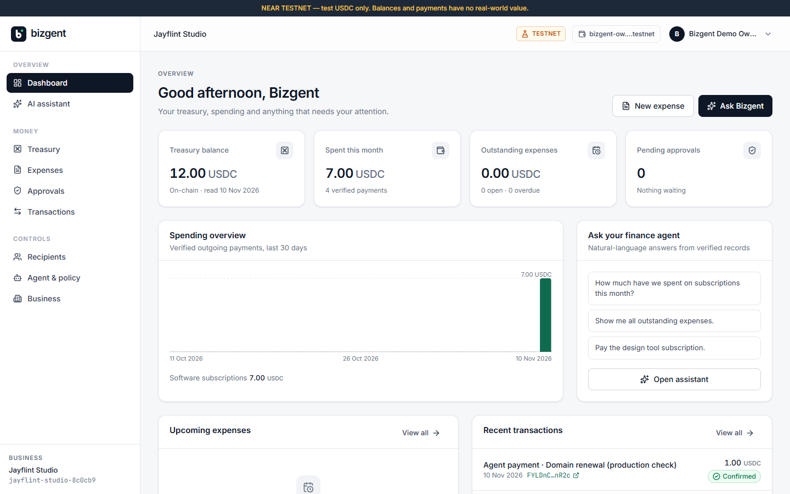

# Bizgent

**An AI finance agent for small businesses that pays routine bills in USDC on NEAR — but only
inside spending limits a smart contract enforces. Everything else needs the owner's wallet signature.**

NEAR HACKATHON 2026 · Tracks: Autonomous Business, AI Security & Defense ·
**NEAR testnet only · unaudited contract · test USDC has no real value**

| | |
|---|---|
| Live app | **https://bizgent.vercel.app** |
| Demo video (2:04, voice-over + captions) | [`docs/video/bizgent-demo.mp4`](docs/video/bizgent-demo.mp4) — recorded against the live app on 2026-11-11 |
| Backend API | https://bizgent-api.onrender.com · health: **https://bizgent-api.onrender.com/api/v1/health** |
| Vault contract | [`vault.bizgent-operator-jayflint-2026-testnet.testnet`](https://testnet.nearblocks.io/address/vault.bizgent-operator-jayflint-2026-testnet.testnet) |
| Agent account | [`agent-udio-8c0cb9.bizgent-operator-jayflint-2026-testnet.testnet`](https://testnet.nearblocks.io/address/agent-udio-8c0cb9.bizgent-operator-jayflint-2026-testnet.testnet) (function-call key for `agent_pay` only) |
| USDC (Circle, native, testnet) | [`3e2210e1…b8af`](https://testnet.nearblocks.io/address/3e2210e1184b45b64c8a434c0a7e7b23cc04ea7eb7a6c3c32520d03d4afcb8af) |

> The backend runs on Render's free plan and sleeps when idle — the first request can take ~50 s.

## The problem
Small businesses pay the same bills every month (software, hosting, contractors). Handing that
job to an AI agent is attractive, but giving an AI a wallet means trusting it with all the money:
one prompt injection or bug and the treasury is gone. Bizgent lets an agent do the routine work
while **the blockchain, not the AI, decides how much it can spend and to whom.**

## How it works
1. The owner deposits USDC into their business's isolated balance in the Bizgent **vault contract**.
2. On-chain, the owner sets a **per-payment limit**, a **daily limit**, and a list of **approved recipients**, and authorises one **agent account**.
3. The owner (or the AI assistant) creates a payment for an expense. A deterministic **policy engine** reads live vault state and decides:
   - `auto` — approved recipient, within both limits, enough balance → the server signs `agent_pay` with the agent's **function-call key**. The contract re-checks every rule.
   - `needs_approval` — anything else → an approval email; the owner opens the app, logs in and signs the exact `owner_pay` transaction **with their own wallet**.
4. The backend verifies the transaction outcome, the contract's event log and the vault's payment record before showing **Paid**. No mock success exists in the live path.



## Architecture
```
Browser (React, Vite, Tailwind, @hot-labs/near-connect wallet)
   │  same-origin /api (Vercel rewrite)              owner signs owner txs in wallet
   ▼                                                           │
Express API on Render ── MongoDB Atlas (records, audit log)    │
   │  ├─ policy engine (deterministic)                         │
   │  ├─ NEAR AI Cloud (OpenAI-compatible, tool calling)       │
   │  ├─ Brevo (approval / payment emails)                     │
   │  └─ agent signer: function-call key → agent_pay only      │
   ▼                                                           ▼
NEAR testnet: Bizgent vault contract (Rust) ◀── ft_transfer_call ── Circle USDC (NEP-141)
```
Details: [docs/ARCHITECTURE.md](docs/ARCHITECTURE.md) · [docs/CONTRACT_INTERFACE.md](docs/CONTRACT_INTERFACE.md) · [docs/API.md](docs/API.md) · [docs/SECURITY.md](docs/SECURITY.md)

## How NEAR is used
- **Vault contract** (`contracts/vault`, Rust, near-sdk 5.29.1): one contract holds many businesses with isolated balances. Deposits arrive through NEP-141 `ft_transfer_call` with the business id in `msg`; `ft_on_transfer` accepts only the configured USDC contract (predecessor check) and refunds anything malformed.
- **Function-call access keys**: the agent account has no full-access key. Its only key may call `agent_pay` on the vault — it cannot transfer NEAR, withdraw, or change limits.
- **1-yocto owner methods**: `set_policy`, `set_agent`, `revoke_agent`, `add_recipient`, `withdraw`, `owner_pay`… require an attached deposit, which function-call keys can never attach, so only the owner's full-access wallet key can call them.
- **Contract-enforced policy**: `agent_pay` checks the caller is the business's agent, the agent isn't paused, the recipient is approved, `amount ≤ max_per_tx`, the UTC-day total ≤ `daily_limit`, the balance, and that `payment_id` was never used.
- **Safe transfers**: the balance is debited before `ft_transfer`; a callback restores it if the transfer fails. NEP-297 events (`standard: "bizgent"`) are emitted for every movement.
- **NEP-413 signed messages** link a NEAR wallet to the user account. **NEP-145** storage registration is checked live for every recipient.

## How the AI agent works
The assistant (NEAR AI Cloud, default model `anthropic/claude-haiku-5-5`) gets a short system prompt and a few
read-only tools (expenses, spending, balance) plus one write tool, `createPaymentProposal`. It has **no
key and no authority**: its proposal goes through the same policy engine and contract checks as a
human's. Cost caps: daily request limit, history window, max tool rounds, max output tokens.
If the AI is unavailable the UI says so and offers **manual payment**; manual proposals are never labelled as AI.

## Owner control
- Owner actions are prepared by the backend and **signed in the owner's own wallet**; the backend never holds an owner key.
- An approval is bound to a SHA-256 hash of recipient, amount, payment id and purpose, and expires. **Clicking an email link never moves money** — it opens the app, where the owner must be logged in and sign.
- Withdrawals are never blocked, even when the vault is paused. Revoking or pausing the agent takes effect on-chain immediately.

## Verified on NEAR testnet (2026-11-10)
These were executed through the real API against the deployed contract (script: `server/scripts/near/e2e-testnet.js`, 21/21 checks):

| Step | Transaction |
|---|---|
| Owner registers business on-chain | [YYkPm4gt…](https://testnet.nearblocks.io/txns/YYkPm4gtLC92NTrrswg3vvYNEkBTtSdiA9f6F42ByFA) |
| Owner sets policy (2 USDC/payment, 5 USDC/day) | [65UcfRJF…](https://testnet.nearblocks.io/txns/65UcfRJFgADWQVTGsEAdzP1zQsBa5PqFHGpTbJg1nkA7) |
| Owner approves recipient | [Eds7ByDF…](https://testnet.nearblocks.io/txns/Eds7ByDFiVxPh4LqT1ZfG4piQFZXzbEhyaDccgMfuxW6) |
| Deposit 10 USDC (`ft_transfer_call`) | [CKG1aten…](https://testnet.nearblocks.io/txns/CKG1atenM3sm8BAZ96HKCQwBKPS9uBaA2PVCSHuyE8Vy) |
| Agent auto-pays 1.5 USDC (function-call key) | [44GkmxQy…](https://testnet.nearblocks.io/txns/44GkmxQyQ256kkUo2r1qivrp78hnWgxaBN7yrLHum9BJ) |
| Contract rejects replayed `payment_id` | [r7oz1WZj…](https://testnet.nearblocks.io/txns/r7oz1WZjCNMxTPih2eM5Eoxsvxo4ZBcXNhvsTAWC4B9) |
| Contract rejects 3 USDC (> per-payment limit) | [233rT8zG…](https://testnet.nearblocks.io/txns/233rT8zG7SpYF6QnRkeNUmiNSBhxWTHtxd56yuYzqbHV) |
| Contract rejects non-approved recipient | [DVNZqwjL…](https://testnet.nearblocks.io/txns/DVNZqwjL43SBHj4f7dMyieqZektonojCNvcVQXXQwkCU) |
| Contract rejects `agent_pay` from a non-agent account | [48SPKqTA…](https://testnet.nearblocks.io/txns/48SPKqTA36RxG2PZip1Ko9BaYiAYSje5AQPkoUrLUHwW) |
| Owner signs out-of-policy 3 USDC `owner_pay` | [J7sFgmHL…](https://testnet.nearblocks.io/txns/J7sFgmHL51qa483vJkWXig2PF9kYYHvSrQia3F9UQfrS) |
| Agent rejected after `revoke_agent` | [9WjHVz37…](https://testnet.nearblocks.io/txns/9WjHVz37YwTZUKcZZDhWxXFbNP6Sk3nFKHMw84zb7PSD) |
| Owner withdraws 1 USDC | [14pov3eD…](https://testnet.nearblocks.io/txns/14pov3eDvxup9bp1pwD67epr71vZtGXHUoqfsYU7bMZs) |
| Agent payment executed by the **hosted** Render backend | [FYLDnCYj…](https://testnet.nearblocks.io/txns/FYLDnCYjtj5pLY4vc3tEQuRf9DNahoZMieFMfxGGnR2c) |
| **AI assistant** (NEAR AI Cloud, live): "Pay the design tool subscription." → `createPaymentProposal` → policy `auto` → agent pays 1 USDC | [9jhXvSBs…](https://testnet.nearblocks.io/txns/9jhXvSBsS5ZzgGBk9GVsMGnHhnpj6SsBGcJAG3NDoopY) |
| Demo video (2026-11-11): AI assistant "Pay the cloud storage invoice." → policy `auto` → agent pays 1 USDC | [7Q3j5Dkt…](https://testnet.nearblocks.io/txns/7Q3j5DktN9fybAEytvRwXbsF9dWPYcQBVsFn6SCLhb38) |
| Demo video (2026-11-11): AI proposes a 3 USDC licence → over limit → approval → owner signs `owner_pay` | [9FP8ndAW…](https://testnet.nearblocks.io/txns/9FP8ndAW7EyMiNTp8cqcC5tRRn5XRo2dtXeNeYfcRZwQ) |

Contract deployment: [create](https://testnet.nearblocks.io/txns/4Uho8uDin2q9dCVehBbCaYSx3ggHMYg9EnhcYqG7xKTW) · [deploy wasm](https://testnet.nearblocks.io/txns/4oVKUiJbywnFnyzuuwR5BGjux8yQ9KYmqnfRy7hKxLxh) (sha256 `f132ad55…a121`, built in GitHub Actions) · [init](https://testnet.nearblocks.io/txns/5UFWgvZrSdNSH42aSyuXW1o1WU34fGUwrS5gpA5sC8fq).
Agent key restriction: [add function-call key](https://testnet.nearblocks.io/txns/CfgvpmZ3qnjfXoHKeYXGVkLxRfVKvvGEA3gq56ZmXbc1) · [delete full-access key](https://testnet.nearblocks.io/txns/Df5TbAw1mJDJwuPQKeg92TzrKUmD1LTzpBHB4Zshb4hu).

## Judge walkthrough (hosted app)
You need nothing installed for steps 1–6. Steps 7+ need a NEAR **testnet** wallet (HOT, Meteor or MyNearWallet testnet) with ~1 testnet NEAR; step 9 also needs test USDC from [faucet.circle.com](https://faucet.circle.com) (network: NEAR Testnet).

Step 1: Open https://bizgent.vercel.app.
Expected result: Landing page with an orange "NEAR TESTNET — test USDC only" banner.

Step 2: Click **Get started**, create an account (any email format is accepted; no verification needed).
Expected result: You land on the dashboard of a new business. Treasury balance shows "Unavailable"/"Not registered" — never a fake 0.

Step 3: Open **Recipients → Add recipient**, enter name `Test supplier`, account `supplier.bizgent-operator-jayflint-2026-testnet.testnet`.
Expected result: The recipient is saved with **USDC registered: Yes** (checked live against the USDC contract). An unregistered account (e.g. `nobody-xyz.testnet`) shows **No**.

Step 4: Open **Expenses → New expense**, amount `2.5`, link the recipient.
Expected result: Expense listed as Unpaid with 2.50 USDC (stored as `2500000` base units).

Step 5: On the expense, click **Pay**.
Expected result: The policy engine decides **Needs approval** and lists the reasons (business not registered on-chain / no agent). An approval appears under **Approvals**, and an approval email is sent via Brevo.

Step 6: Open **AI assistant** and ask "What is our balance?".
Expected result: An answer from the NEAR AI model built from your real records (it calls tools such as `getBusinessBalance`). If AI credits are ever exhausted you instead see a clear "AI unavailable" message with **Create payment manually** — never a fake AI reply.

Step 7: Open **Profile** (account menu, top right) → **Connect & link wallet**, choose your testnet wallet and sign the message.
Expected result: The header shows your account; the server verified a NEP-413 signature against your account's full-access key.

Step 8: Open **Business** (sidebar) → **Register with wallet (0.1 NEAR storage)** and approve in your wallet.
Expected result: A `register_business` transaction on the vault; the business shows **Registered** (read back from the contract).

Step 9: Open **Treasury → Deposit**, enter `2`, approve `ft_transfer_call` in your wallet.
Expected result: The transaction appears under **Transactions** as **Confirmed** with a NearBlocks link, and the balance (read from the vault) increases by 2.00.

Step 10: Open **Agent & policy**: set limits (e.g. 1 / 3 USDC) → **Save limits on-chain**; click **Authorise agent**; then on **Recipients** click **Approve** for the supplier. Each opens your wallet.
Expected result: The page shows the contract state: limits, agent **Active**, recipient **Approved on-chain**.

Step 11: Create an expense of `0.5` USDC to the supplier and click **Pay**.
Expected result: Decision **auto**; the hosted agent signs `agent_pay`; the payment shows **Confirmed** with a NearBlocks link whose signer is the agent account.

Step 12: Create an expense of `2` USDC (above your 1 USDC limit) and click **Pay**, then open it under **Approvals** and click **Approve & sign with wallet**.
Expected result: Decision **needs approval**; your wallet shows `owner_pay` for exactly 2 USDC to the supplier; after signing it becomes **Confirmed**.

Step 13: On **Agent & policy** click **Revoke agent**, then try another 0.5 USDC payment.
Expected result: The payment now needs your approval; the agent can no longer pay.

Step 14: **Treasury → Withdraw** any amount.
Expected result: USDC returns to your wallet; the withdrawal is verified and listed.

Note: the hosted backend has one agent signer account. Any test business may authorise it (step 10); the contract
still isolates balances, limits and recipients per business. In production each business would get its own agent account.

**Without a wallet**, the demo business above shows the full result: see the screenshots in `docs/screenshots/` and the transaction table.

## Real vs. simulated vs. not implemented
| Real (testnet) | Simulated / limited | Not implemented |
|---|---|---|
| Vault contract, deposits, agent & owner payments, withdrawals, revocation, on-chain verification | Backend unit tests use a simulated vault (the on-chain script above covers the real one) | Mainnet, NEAR Intents, Chain Signatures |
| Function-call-key agent, NEP-413 wallet linking, NEP-145 checks | `[DEMO]` mock UI exists only with `VITE_ENABLE_MOCKS=true` in dev; production builds refuse it | WhatsApp, invoice upload/OCR, teams, multi-business UI |
| Brevo approval & payment emails (sent from Render); NEAR AI Cloud assistant with tool calling (live, `claude-haiku-5-5`) | AI usage is capped at 100 requests/day on hackathon credits; if they run out the UI shows the AI-unavailable fallback with manual payment | Contract audit, 2FA |

## Run locally
Requirements: Node ≥ 20. Rust is not needed (the wasm is built in GitHub Actions; `contracts/vault` has 20 unit tests run in CI).
```bash
git clone https://github.com/bizgent-assist/bizgent && cd bizgent

# backend
cd server && cp .env.example .env    # set JWT_SECRET (any 32+ random chars); other values optional
npm install
npm run dev:memory                    # in-memory MongoDB, no Atlas needed → http://localhost:4000/api/v1/health
npm test                              # 24 API tests (in-memory MongoDB + simulated vault)

# frontend (new terminal)
cd client && cp .env.example .env
npm install && npm run dev            # http://localhost:5173 (proxies /api to :4000)
```
To use the deployed testnet vault locally, set in `server/.env`: `BIZGENT_CONTRACT_ID=vault.bizgent-operator-jayflint-2026-testnet.testnet`
and in `client/.env`: `VITE_BIZGENT_CONTRACT_ID=` the same value. Without a vault, AI key or Brevo key the app still runs and
shows clear "not configured" states (never fake balances).

**Database**: any MongoDB ≥ 6 (`MONGODB_URI`); Atlas works (allow the server's IP in Network Access). `npm run dev:memory` needs nothing.
On Windows, if `mongodb+srv` lookups fail in Node, set `DNS_SERVERS=8.8.8.8,1.1.1.1`.

**Wallet**: any NEAR testnet wallet supported by `@hot-labs/near-connect`. Linking signs a NEP-413 message; no transaction.

### Environment variables (placeholders — see `server/.env.example`, `client/.env.example`)
| Backend | Purpose |
|---|---|
| `MONGODB_URI`, `JWT_SECRET` | database, session signing |
| `FRONTEND_URL`, `ALLOWED_ORIGINS`, `APP_BASE_URL`, `TRUST_PROXY` | origin checks, email links, proxy hops |
| `NEAR_NETWORK=testnet`, `NEAR_RPC_URL`, `BIZGENT_CONTRACT_ID`, `USDC_CONTRACT_ID`, `USDC_DECIMALS=6` | chain config (mainnet requires `MAINNET_ENABLED=true`) |
| `AGENT_ACCOUNT_ID`, `AGENT_PRIVATE_KEY` | agent signer — **function-call key only** |
| `AI_PROVIDER`, `AI_BASE_URL`, `AI_API_KEY`, `AI_MODEL`, `AI_DAILY_REQUEST_LIMIT` | NEAR AI Cloud |
| `BREVO_API_KEY`, `BREVO_SENDER_EMAIL`, `BREVO_SENDER_NAME`, `SUPPORT_EMAIL`, `BREVO_WEBHOOK_TOKEN` | email |

Frontend variables are public (`VITE_*`: network, RPC, explorer, contract ids). No secrets go in the client.

### Reproduce the on-chain demo with your own accounts
See [docs/TESTNET.md](docs/TESTNET.md): `npm run near:deploy` → register business → `npm run near:create-agent` → `node scripts/near/e2e-testnet.js`.

## Tech used
React 19, Vite 8, Tailwind 4, react-router 7, axios, lucide-react, `@hot-labs/near-connect` · Node/Express 5, Mongoose 9, Joi, helmet, express-rate-limit, bcryptjs, jsonwebtoken ·
`near-api-js` 7 (RPC, signing, NEP-413) · Rust `near-sdk` 5.29.1, `cargo-near` · NEAR AI Cloud · Brevo · MongoDB Atlas · Vercel · Render · GitHub Actions.

## Hackathon disclosures
- All code was written during the hackathon window (first commit 2026-11-06). No pre-existing codebase.
- Built with substantial help from an AI coding assistant (Claude Code); open-source libraries listed above.
- NEAR only; no other chains. No other hackathon projects by this team.
- License: [MIT](LICENSE).

More: [HACKATHON.md](HACKATHON.md) (submission notes, demo script) · [docs/DEPLOYMENT.md](docs/DEPLOYMENT.md) · [docs/SECURITY.md](docs/SECURITY.md)
